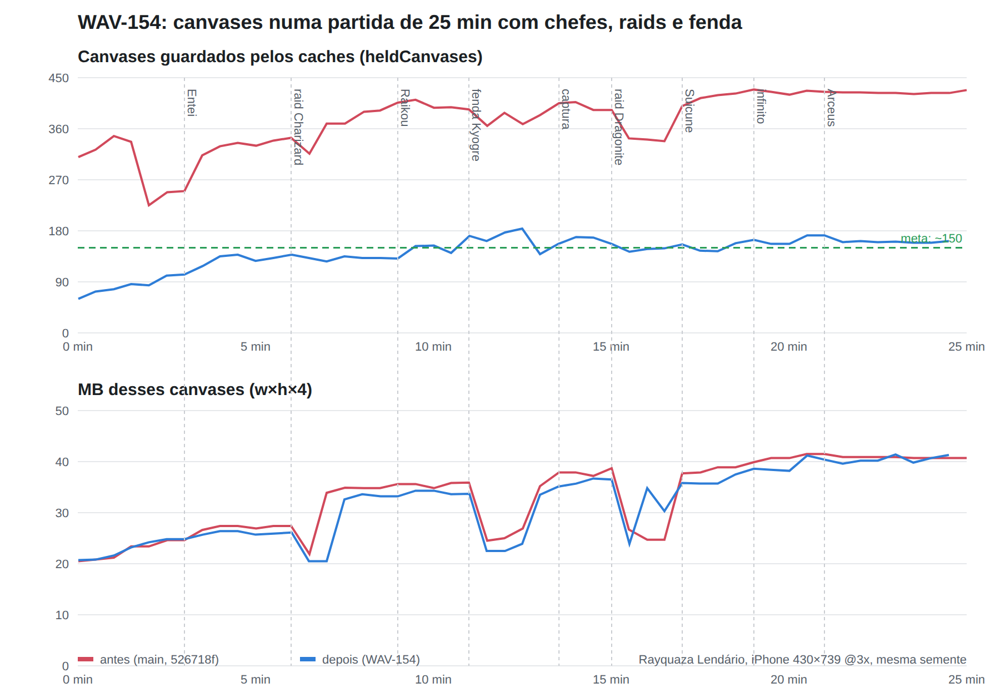

# WAV-154: evidências

Medição de canvases guardados pelos caches (`heldCanvases`, a mesma contagem do diagnóstico "canvas: N (X MB, peak Y MB / N)") numa partida de 25 min.

- **Emulação**: Chromium headless (Playwright) como iPhone Safari: viewport 430×739 @3x, touch, `isMobile`, user agent do iOS 18.2.1.
- **Mesma semente nas duas medições**: `Date.now` fica fixo até o jogo carregar (a semente da próxima partida sai dele), então mapa, elenco e biomas são os mesmos.
- **Antes**: `main` em 526718f (só com rótulos de diagnóstico nos caches internos do `pixelart`), porta 5176. **Depois**: a branch do WAV-154, porta 5175. Dev server (`ps.*`).
- **Roteiro** (`run25.mjs`, minuto de relógio): Rayquaza no Modo Lendário (`ps.captureAll()`, `ps.legend('rayquaza')`), modo deus (HP cheio a cada 100 ms), escolhas automáticas (tecla 1), `ps.awaken()` ×2 (Mega Rayquaza); 1: `ps.learn` de 6 golpes no Lv 8; 3: `ps.boss('entei')`; 6: `ps.tera('enter', 'raidCharizard', 'fire', 6)`; 9: `ps.boss('raikou')`; 11: `ps.rift('kyogre')`; 12: `ps.riftAct('battle', 2)`; 13,5: `ps.riftAct('capture')`; 15: raid Dragonite; 17: `ps.boss('suicune')`; 19: `ps.victory()` e modo infinito (`ps.endless`); 21: `ps.reaper()` (Arceus). Os chefes das ondas normais (Snorlax aos 5:00, Regice etc.) também vieram.
- O "depois" terminou em 24,5 min: o processo do Vite bateu o limite de tempo e caiu na última amostra.

## Resultado

Ver [`tabela.md`](tabela.md). Resumo: canvases média/máx 378/429 → 145/184; MB médios 33,5 → 32,2.

## Prints e vídeo (contador na tela)

`prints/`: a mesma luta (`ps.endless(19.5)`, Arceus, depois raid Charizard) antes e depois, com o contador. `*-boss-raid.webm` é o vídeo de cada uma. `*-meadow.png` confere que o quadro é o mesmo (minimapa, montanha, grama, baú, altar); a fonte da HUD difere só porque a cópia "antes" não serviu duas fontes da interface (403).

## Arquivos

- `before.jsonl`, `after.jsonl`: uma amostra a cada 30 s (canvases, MB, heap JS, inimigos, projéteis, chefe) e, a cada minuto, os 40 caches com mais canvases.
- `extra/`: medições anteriores (semente aleatória; primeiras versões da correção).
- Scripts: `common.mjs`, `run25.mjs`, `prints.mjs`, `look.mjs`, `probe.mjs`, `chart.py`, `svg2png.mjs`.
